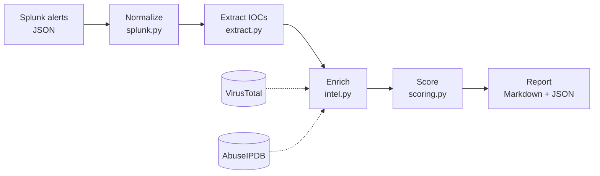

# splunk-alert-triage


A Python tool that automates first-pass SOC triage for Splunk alerts. It pulls indicators of compromise out of each alert, checks them against VirusTotal and AbuseIPDB, and assigns an explainable verdict: **escalate**, **investigate**, or **likely benign**.

> **TODO (you):** One or two sentences in your own words on why you built this, e.g. what you noticed doing manual triage in your Splunk detection lab.

## How it works



1. **Normalize.** Reads Splunk webhook payloads, search exports (one JSON object per line), or JSON lists, and maps common CIM fields (`src_ip`, `dest_host`, `user`, …) into one internal format.
2. **Extract.** Finds IPs, URLs, domains, and MD5/SHA1/SHA256 hashes, including defanged ones like `hxxps://evil[.]com`.
3. **Enrich.** Looks up public indicators in VirusTotal (IPs, domains, URLs, hashes) and AbuseIPDB (IPs). Private IPs are skipped, repeat lookups are cached, and VirusTotal requests are spaced to respect the free-tier rate limit.
4. **Score.** Applies the rules in `config/scoring.yaml` and records the reason behind every decision.
5. **Report.** Writes `reports/triage_report.md` for analysts (most urgent first, links defanged) and `reports/triage_report.json` for other tools.

## Scoring rules

| Condition | Verdict |
|---|---|
| Any indicator rated high (e.g. ≥5 VirusTotal engines, or AbuseIPDB confidence ≥75) | Escalate |
| Any indicator rated medium | Investigate |
| Any public indicator that couldn't be checked | Investigate |
| No public indicators at all | Investigate |
| Everything checked and clean | Likely benign |
| "Investigate" on a privileged account or critical host | Raised to Escalate |

Two deliberate design choices:

- **No data is not proof of safe.** A brand-new phishing domain has no VirusTotal history, so a failed or empty lookup sends the alert to a human instead of auto-closing it.
- **Context changes priority.** The same suspicious IP matters more when it touches a domain admin account or a domain controller.

All thresholds live in `config/scoring.yaml`, so tuning doesn't require code changes.

## Quick start (Windows)

```cmd
git clone https://github.com/YOUR-USERNAME/splunk-alert-triage.git
cd splunk-alert-triage
python -m venv .venv
.venv\Scripts\activate
pip install -e ".[dev]"
```

Try it without API keys:

```cmd
python -m triage samples/alerts --offline
```

For live enrichment, copy `.env.example` to `.env` and add your free [VirusTotal](https://www.virustotal.com) and [AbuseIPDB](https://www.abuseipdb.com) keys, then:

```cmd
python -m triage samples/alerts
```

Point it at your own alerts with a file or folder path. Options: `--out` (report folder), `--config` (scoring file), `--offline`.

## Example output

> **TODO (you):** paste a section of a real `triage_report.md` from a live run here.

## Testing

```cmd
pytest -v
ruff check .
```

Tests never call the real APIs. Each client accepts an injected HTTP session, and the tests pass a fake one that returns saved responses from `tests/fixtures/`. That keeps tests fast, free, and runnable in CI without secrets. GitHub Actions runs linting and the full suite on Python 3.12 and 3.14 for every push and pull request.

## Project structure

```
src/triage/
  splunk.py      load and normalize Splunk alerts
  extract.py     IOC extraction, refang/defang
  intel.py       VirusTotal + AbuseIPDB clients, caching enricher
  scoring.py     verdict rules
  report.py      Markdown and JSON output
  cli.py         command-line entry point
config/scoring.yaml   tunable thresholds
samples/alerts/       sample alerts
tests/                pytest suite and mocked API responses
```

## Limitations

- Domains are only extracted from URLs. Bare domains in free text (e.g. an email sender's domain) are not checked, because matching them reliably without false positives (like `invoice.exe`) needs more work.
- IPv6 addresses are not extracted yet.
- Free API tiers are slow: VirusTotal allows about 4 lookups per minute, so large batches take time.
- Scoring is threshold-based, not a statistical model, so it's simple to audit but won't catch everything.

## Possible next steps

- Slack or Teams webhook for escalations
- Bare-domain and IPv6 extraction
- Persistent cache between runs
- Pull alerts directly from the Splunk REST API

## Credits

Built with assistance from [Claude](https://claude.ai) (Anthropic). I reviewed, tested, and modified all code.

> **TODO (you):** adjust this to describe what you changed.

## License

MIT — see [LICENSE](LICENSE).
